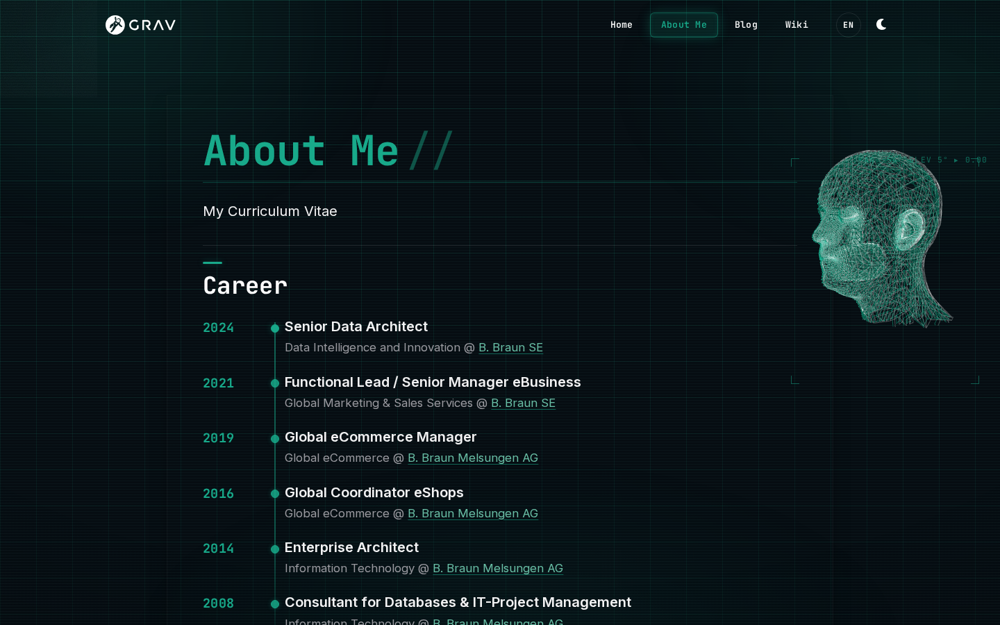

# Grava the HUD

**Grava the HUD** is a theme for [Grav CMS](https://github.com/getgrav/grav) 2.1 with a raw *technical HUD* aesthetic: monospace chrome, glowing accent pills, an ambient grid + aurora + grain background and a scroll-driven wireframe head illustration. It is a fork of [Quark 2](https://github.com/getgrav/grav-theme-quark2) — the modernized Grav default theme built on [Blades CSS](https://github.com/anyblades/blades) — and keeps its structure, blueprints and templates while replacing the look and several behaviours.



## Look & behaviour

* **HUD aesthetic** — JetBrains Mono for UI chrome (nav, labels, meta, footer), Cal Sans display + Inter body (all hosted locally as woff2), teal accent that tints links, focus rings, pills and glows
* **Ambient background** — faint HUD grid, aurora wash and film grain, tuned separately per theme mode
* **Glass nav with glowing active pill**, sticky header that condenses on scroll, transparent-header variants (`header-dark` / `header-light`)
* **Scroll-driven wireframe head** (About page gutter): the scanned `LeePerrySmith` head from the three.js examples, rendered as sparse wireframe `LineSegments` over the page background with an offset ghost layer, orbiting left → front → lateral as you scroll. three.js r180 and the GLTF loader are vendored in `js/` — no CDN needed
* **Two-state theme toggle** — light ↔ dark; initial mode is your stored choice, else the OS `prefers-color-scheme`; while nothing is stored, OS changes still follow live. No FOUC: a pre-paint bootstrap in `templates/partials/base.html.twig` sets the theme before first paint
* **Single language toggle button** — shows the language you are in, links the same page in the other language (works without JS); on first visit the browser language decides and is stored
* **Scroll reveals** via `animation-timeline: view()` for cards (deliberately *not* for long article bodies — a reveal on an element taller than the viewport keeps its text dim at the top of the page)
* Multi-level dropdown navigation, full-page mobile menu overlay, sticky footer option, configurable accent color via the admin color picker

## Supported page templates

* Default `default.md`, Error `error.md`
* Blog `blog.md`, Blog item `item.md`, Comments `comments.md`
* Modular `modular.md` — `features.md`, `hero.md`, `text.md`, `gallery.md` (gallery needs the premium [Lightbox Gallery](https://getgrav.org/premium/lightbox-gallery/docs) plugin)

## Installation

### GPM (preferred)

```bash
bin/gpm install grav-theme-grava-the-hud
```

### Manual

Clone into your Grav install and point Grav at it in `user/system.yaml`:

```bash
git clone https://github.com/handtrixxx/grav-theme-grava-the-hud user/themes/grava-the-hud
```

```yaml
pages:
  theme: grava-the-hud
```

Then clear the cache (`bin/grav clear-cache`). The theme folder name must match the `slug` in `blueprints.yaml` and the PHP class file name (`grava-the-hud.php`).

## Development

CSS is authored directly (`css/theme.css`, `css/custom.css`); `css/blades.min.css` is the minified Blades foundation. `package.json` only carries the Blades build tooling:

```bash
npm install
npm run build:css
```

## Attribution & licenses

* Forked from **Quark 2** by Team Grav / Trilby Media, © 2018, MIT — see `LICENSE` (kept unchanged) and `CHANGELOG.md` for the upstream history
* [Blades CSS](https://github.com/anyblades/blades) — MIT
* [three.js](https://threejs.org) r180 (`js/three.core.min.js`, `js/three.module.min.js`, `js/addons/*`) — MIT
* `js/models/LeePerrySmith.glb` — scanned head model from the three.js examples
* Fonts: Cal Sans, Inter, JetBrains Mono — SIL Open Font License
* [Font Awesome 7](https://fontawesome.com) free set — CDN by default, self-host option in the theme settings
